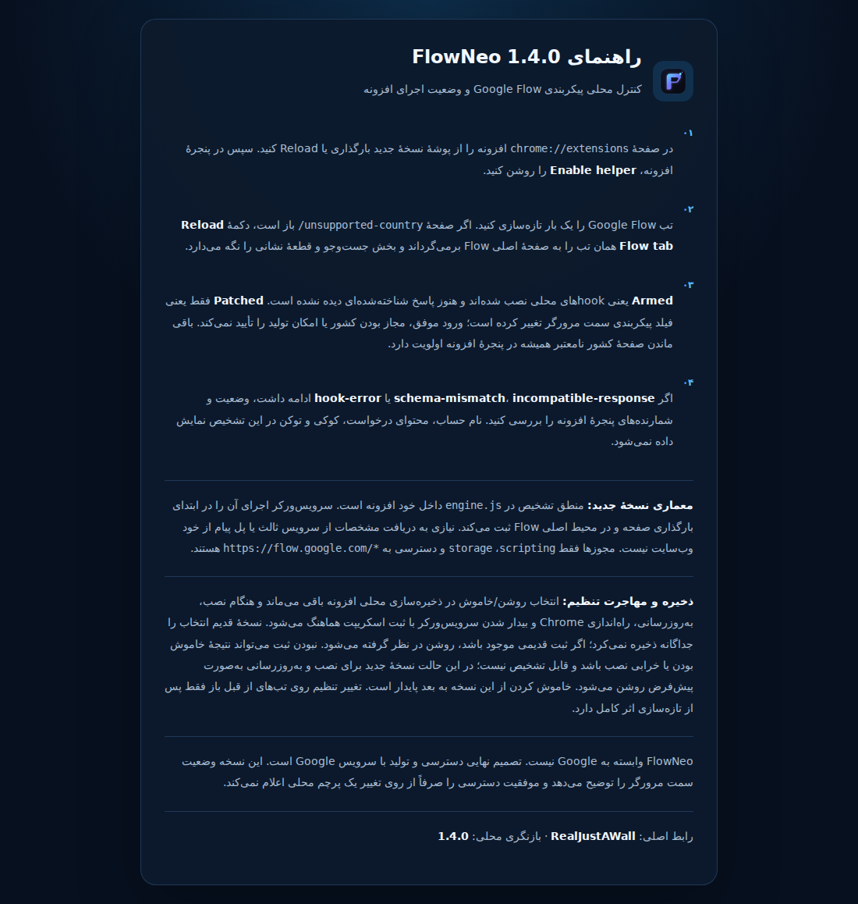

<div align="center">


**افزونهٔ Chrome برای کنترل پایدار ابزار محلی Google Flow، نمایش وضعیت تشخیصی و دسترسی سریع به عملیات تب.**


<a href="https://github.com/Realjustawall/FlowNeo/releases/latest"></a>
<a href="docs/gallery.fa.md"></a>
<a href="#quick-start"></a>
<a href="https://github.com/Realjustawall/FlowNeo/issues"></a>

[English](README.md) · [فارسی](README.fa.md)

</div>

---

[قابلیت‌های شاخص](#features) · [پیش‌نمایش](#preview) · [راه‌اندازی](#quick-start) · [توسعه](#development) · [مستندات](#documentation) · [امنیت و حریم خصوصی](#security) · [مجوز و بازخورد](#license)

<a id="features"></a>

## قابلیت‌های شاخص

| قابلیت | کاربرد |
|---|---|
| کنترل پایدار | ذخیرهٔ وضعیت ابزار و هماهنگ‌سازی ثبت اسکریپت هنگام بیدار شدن سرویس‌ورکر. |
| تشخیص محلی | وضعیت پاسخ شناخته‌شده، شمارندهٔ مشاهده و کد خطای محدود. |
| عملیات سریع | باز کردن Google Flow و تازه‌سازی تب فعال از پنجرهٔ افزونه. |
| دسترسی محدود | Manifest V3 با مجوزهای scripting و storage و دسترسی به میزبان Google Flow. |

<a id="preview"></a>

## پیش‌نمایش

تصویر فارسی، راهنمای اصلی افزونه است، نه پنل فارسی. پنل اصلی انگلیسی است و در گالری انگلیسی با آداپتور آزمایشی Chrome API و وضعیت روشن شبیه‌سازی‌شده نمایش داده می‌شود.



[مشاهدهٔ گالری کامل](docs/gallery.fa.md)

<a id="quick-start"></a>

## راه‌اندازی

۱. فایل **FlowNeo-v1.4.0-FIXED.zip** را از ریلیز بگیرید و استخراج کنید.
۲. `chrome://extensions` را باز کنید، **Developer mode** را روشن کنید و **Load unpacked** را بزنید.
۳. پوشهٔ دارای `manifest.json` را انتخاب و افزونه را سنجاق کنید.
۴. پنجرهٔ افزونه را باز کنید، **Enable helper** را تنظیم کنید و تب‌های باز Google Flow را تازه‌سازی کنید.

پس از به‌روزرسانی فایل‌ها، خود افزونه و تب‌های Flow را دوباره بارگذاری کنید. توضیح حالت‌های تشخیص در [راهنمای داخلی فارسی](info.html) آمده است.

<a id="development"></a>

## توسعه

نیازی به bundler یا نصب npm نیست. پوشهٔ سورس را به‌صورت افزونهٔ unpacked بارگذاری کنید.

```bash
git clone https://github.com/Realjustawall/FlowNeo.git
cd FlowNeo
```

دستورهای بررسی:

```bash
node --check app.js
node --check engine.js
node --check stat.js
node --check panel.js
```

<a id="documentation"></a>

## مستندات

- [راهنمای داخلی فارسی](info.html)
- [مجوزهای اعلام‌شده](manifest.json)
- [موتور محلی ابزار](engine.js)
- [نسخهٔ حفظ‌شدهٔ مستندات پیشین](REFERENCE.md)

<a id="security"></a>

## امنیت و حریم خصوصی

FlowNeo وابسته به Google نیست. تغییر پیکربندی محلی، مجاز بودن کشور یا عبور از بررسی سمت سرور Google را اثبات نمی‌کند. نسخهٔ ۱٫۴٫۰ تشخیص را محلی انجام می‌دهد؛ مجوزهای فعلی `scripting` و `storage` و دسترسی به `https://flow.google.com/*` هستند. میزبان ثالث دریافت مشخصات در manifest فعلی وجود ندارد.

<a id="license"></a>

## مجوز و بازخورد

فایل مجوز در ریشهٔ مخزن ارائه نشده است. پیش از بازتوزیع یا استفادهٔ مجدد با نگهدارنده هماهنگ کنید.

[گزارش اشکال و پیشنهاد بهبود](https://github.com/Realjustawall/FlowNeo/issues). نسخه، سیستم‌عامل و روش بازتولید را بنویسید و اطلاعات خصوصی یا رمزها را در گزارش قرار ندهید.

---

نگهداری توسط **[Realjustawall](https://github.com/Realjustawall)**.
