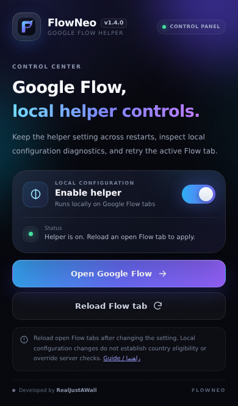

<div align="center">


**A Chrome extension for persistent local Google Flow helper controls, bounded diagnostics and convenient tab actions.**


<a href="https://github.com/Realjustawall/FlowNeo/releases/latest"></a>
<a href="docs/gallery.en.md"></a>
<a href="#quick-start"></a>
<a href="https://github.com/Realjustawall/FlowNeo/issues"></a>

[English](README.md) · [فارسی](README.fa.md)

</div>

---

[Highlights](#features) · [Preview](#preview) · [Quick start](#quick-start) · [Development](#development) · [Documentation](#documentation) · [Security and privacy](#security) · [License and feedback](#license)

<a id="features"></a>

## Highlights

| Capability | What you get |
|---|---|
| Persistent control | Save the helper setting locally and restore script registration when the worker wakes. |
| Local diagnostics | Inspect recognized response state, observation counters and bounded error codes. |
| Convenient actions | Open Google Flow and reload the active Flow tab from the popup. |
| Scoped access | Manifest V3 with scripting/storage permissions and the Google Flow host only. |

<a id="preview"></a>

## Preview

Original English popup rendered with a Chrome API test adapter; the enabled state is simulated. This is not evidence of Google Flow access.



[Open the full gallery](docs/gallery.en.md)

<a id="quick-start"></a>

## Quick start

1. Download **FlowNeo-v1.4.0-FIXED.zip** from the latest release and extract it.
2. Open `chrome://extensions`, enable **Developer mode** and choose **Load unpacked**.
3. Select the folder containing `manifest.json` and pin FlowNeo.
4. Open the popup, set **Enable helper**, then reload open Google Flow tabs.

On updates, replace the extension files, reload the extension and refresh existing Flow tabs. Read the built-in [Persian guide](info.html) for detailed diagnostic states.

<a id="development"></a>

## Development

No bundler or npm installation is required. Load this source directory as an unpacked extension.

```bash
git clone https://github.com/Realjustawall/FlowNeo.git
cd FlowNeo
```

Validation commands:

```bash
node --check app.js
node --check engine.js
node --check stat.js
node --check panel.js
```

<a id="documentation"></a>

## Documentation

- [Built-in Persian guide](info.html)
- [Declared permissions](manifest.json)
- [Local helper engine](engine.js)
- [Preserved documentation reference](REFERENCE.md)

<a id="security"></a>

## Security and privacy

FlowNeo is independent of Google. Changing local client configuration does not establish country eligibility or bypass Google’s server-side checks. Version 1.4.0 performs diagnostics locally; the current manifest grants `scripting`, `storage` and access to `https://flow.google.com/*`. No third-party specification host is declared in the current manifest.

<a id="license"></a>

## License and feedback

No repository-level license file is currently provided. Contact the maintainer before redistribution or reuse.

[Report bugs or discuss improvements](https://github.com/Realjustawall/FlowNeo/issues). Include your version, OS and reproducible steps; keep credentials and private data out of reports.

---

Maintained by **[Realjustawall](https://github.com/Realjustawall)**.
